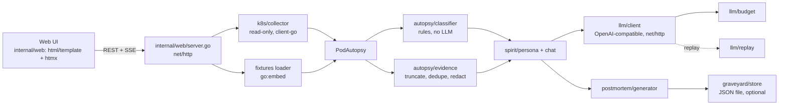
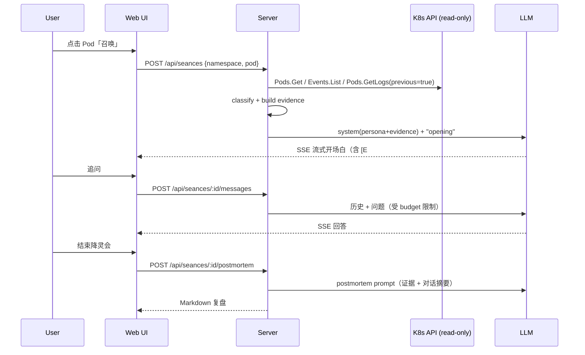

# Design Document

## Overview

单进程本地 Web 应用，用 Go 编写，编译为单个二进制。浏览器访问 `http://localhost:6660`。后端通过当前 kubeconfig 只读读取 K8s 数据，生成 `PodAutopsy`，用确定性规则分类死因，再把精简后的证据包交给 LLM 扮演亡灵；结束时用 LLM + 固定模板生成复盘。

### 形态选择：Web（本地）而不是 CLI

- 选 Web：视频里画面更有记忆点（烛光、雾气、墓碑），评委 3 秒看懂；也能顺带争取「看起来好」的印象。
- 选 Go 单二进制：评委下载即跑，不需要安装其他运行时；`go run ./cmd/seance --fixtures --replay` 即可试用。样例数据用 `go:embed` 打进二进制，不依赖仓库目录。
- 不选纯 CLI：终端聊天在视频里不出彩；但核心逻辑都在 `internal/` 包里，以后加 `seance summon <pod>` 子命令只需几十行（可选加分项）。
- 不做云端部署：评委用 `--fixtures --replay` 本地即可试用，零托管成本。如需在线 demo，可选部署静态回放版（非 MVP）。

## Architecture



### 降灵会时序



## Components and Interfaces

### k8s/collector.go

```go
func ListSpirits(ctx context.Context, cs kubernetes.Interface, namespace string) ([]SpiritSummary, error)
func CollectAutopsy(ctx context.Context, cs kubernetes.Interface, namespace, pod string) (*autopsy.PodAutopsy, error)
```
- 使用 `k8s.io/client-go/kubernetes` 的 `CoreV1()`：`Pods(ns).List`、`Pods(ns).Get`、`Pods(ns).GetLogs(name, &corev1.PodLogOptions{TailLines, Previous})`、`Events(ns).List`（`FieldSelector: "involvedObject.name=<pod>"`）。
- 所需 RBAC（`demo/rbac-readonly.yaml`）：`pods`、`pods/log`、`events` 的 `get/list/watch`。
- `kubernetes.Interface` 作为参数传入，单元测试可换成 fake clientset，不连真集群。
- 只读守卫测试：`go test` 扫描 `internal/` 下所有 `.go` 源码（排除测试文件自身），禁止 `Create`、`Update`、`UpdateStatus`、`Patch`、`Delete`、`DeleteCollection`、`Evict` 方法调用。不把 `Replace` 列入规则，避免误伤 `strings.Replace`。

### autopsy/model.go、classifier.go

`model.go` 定义 `PodAutopsy` 及相关类型（见 Data Models），是采集层与其他模块之间的唯一数据契约。

```go
func Classify(a *PodAutopsy) Classification
```
规则顺序：OOMKilled → ImagePullBackOff/ErrImagePull → CrashLoopBackOff → ProbeFailure（附加）→ Error → Unknown。纯函数，表驱动测试，fixtures 驱动。

### autopsy/evidence.go

```go
func BuildEvidence(a *PodAutopsy, opts EvidenceOptions) ([]Evidence, error)
// EvidenceOptions{TailLines int; MaxChars int}
```
- 产出编号证据 `E1..En`：状态/退出码、limits、镜像、每条事件、日志关键行（最后 N 行 + 含 error/panic/exception/killed 的行）。
- 去重连续重复行；正则脱敏（`token`、`password`、`secret`、`Bearer xxx`、AWS key 形状等）→ `[REDACTED]`。
- 总字符数上限（默认约 6k token 对应的字符数）。

### spirit/persona.go + chat.go

- System prompt 要点（`internal/spirit/prompts/persona.md`，通过 `go:embed` 读入）：
  - 你是 Pod `<name>` 的亡灵，第一人称，阴森、简短（≤ 120 词），带一点黑色幽默。
  - 只能根据下方证据说话，每个事实后标 `[E#]`；证据里没有的，说「冥界没有留下记录」。
  - 用户问修复时，跳出一半角色，给出明确、可执行的建议，但不声称已执行。
  - 语言跟随用户。
- 死因专属「声线」小抄（按 cause 注入一段）：OOMKilled「窒息/越来越重」、CrashLoop「一次次复活又倒下」、ImagePull「我从未真正活过」、Probe「他们以为我死了，于是真的杀了我」。
- 前端解析 `[E#]`，渲染成可点开的证据卡片。

### llm/client.go、budget.go、replay.go

- 一个 OpenAI 兼容 Chat Completions 客户端，`stream=true`，用 `net/http` 直接实现：发送 POST 请求，逐行读取 `data: {...}` 的 SSE 分片，遇到 `data: [DONE]` 结束。不依赖任何 LLM SDK。
- 接口形如 `Stream(ctx context.Context, req ChatRequest, onDelta func(string) error) (Usage, error)`，`onDelta` 把增量文本转发给 SSE。
- 配置来源见下一节「配置」；mock 与录制/回放见「Mock 与录制/回放」。
- 超时 15 秒，失败重试 1 次（见 Error Handling）。
- 成本控制：
  - 证据包代替原始日志；对话历史只保留最近 4 轮 + 证据。
  - `budget.go`：每个 séance 默认最多 6 次调用、单次输入 ≤ 6k token、整场输入合计 ≤ 30k token（每次调用按估算值与供应商报告的输入 token 取较大者累计；`SEANCE_BUDGET_MAX_TOTAL_INPUT_TOKENS` 可覆盖）。单次上限取 6k 与剩余总量中较小者，超出时先丢较早的历史；只超单次上限返回 `ErrInputTooLarge`（不计数），只超剩余总量则本场额度耗尽（`ErrBudgetExhausted`，复盘走规则模板 `budget_exhausted`）。会话 JSON 带 `inputTokensUsed` 和 `inputTokensMax`；聊天调用（开场白、追问）输出 ≤ 400 token，复盘调用（`TurnIndex == PostmortemTurnIndex`）输出 ≤ 1500 token，复盘也只算一次调用。超限返回固定台词。
  - 开场白按 `(podUID, restartCount, model)` 缓存，重复召唤不重复花钱。
  - 复盘的时间线、证据小节由代码直接从 `PodAutopsy` 填，LLM 只写摘要、根因、建议和行动项。
- `replay.go`：`--replay` 时读取 `fixtures/replay/*.json`（经 `go:embed` 打包）。开场白（turnIndex 0）和复盘（turnIndex 100）按 `turnIndex` 匹配；追问按问题文本匹配：请求的最后一条用户消息经 `normalizeQuestion` 规范化后，与录音里的 `lastUser` 比较，多条命中时取 turnIndex 最小的，请求的 turnIndex 不必与录音相同。`SEANCE_RECORD=1` 时写入。

#### 配置

- 不预设任何模型厂商，也没有默认 base URL 或模型名。巨基之后提供接口地址和 API key。
- 配置项：base URL、API key、模型名，三者都必填（mock 模式除外）。
- 来源优先级：环境变量 `SEANCE_LLM_BASE_URL`、`SEANCE_LLM_API_KEY`、`SEANCE_LLM_MODEL` 优先；未设置时读取配置文件 `~/.k8s-seance/config.yaml`。
- 配置文件格式：

  ```yaml
  llm:
    base_url: <OpenAI 兼容接口地址，例如 https://example.invalid/v1>
    api_key: <your key>   # 建议用环境变量；若写入文件，文件权限设为 0600
    model: <模型名>
  ```
- 启动时校验：任一项缺失且未启用 mock / replay 时，日志和界面提示需要配置，并自动进入 mock 模式，不报错退出。
- 客户端只依赖 OpenAI 兼容的 `POST {base_url}/chat/completions`（`stream=true`）协议，换任何兼容服务都只改配置。

#### Mock 与录制/回放（同一个 Provider）

`internal/llm` 定义一个接口，三种实现共用：

```go
type Provider interface {
    Stream(ctx context.Context, req ChatRequest, onDelta func(string) error) (Usage, error)
}
// HTTPProvider：真实的 OpenAI 兼容接口
// ReplayProvider：读取 fixtures/replay/*.json。开场白和复盘按 turnIndex 回放，追问按规范化后的问题文本回放；找不到录音时退回 MockProvider
// MockProvider：按死因 + 证据拼出固定台词（模板），逐字模拟流式输出，带 [E#] 引用
```

- 模式选择：`SEANCE_LLM_MODE=http|replay|mock`，或命令行 `--replay` / `--mock`；默认：配置齐全则 `http`，否则 `mock`。
- 开发阶段默认用 mock：不需要任何 key 就能把对话、复盘、界面全部跑通，测试也用 mock。
- 拿到真实接口后，用 `SEANCE_RECORD=1` 把真实回答录成 `fixtures/replay/`，演示和评委试用走 replay，不联网、不花钱。
- 成本上限（budget）对三种 Provider 都生效，mock/replay 下照样计数，方便提前验证上限逻辑。

### postmortem/generator.go

```go
func GeneratePostmortem(ctx context.Context, a *autopsy.PodAutopsy, cls autopsy.Classification, transcript []Turn, llm llm.Streamer) (string /* markdown */, error)
```
模板 `template.md`（`go:embed`）固定 7 小节：Summary / Timeline / Root Cause / Evidence / Impact / Remediation / Action Items，另有一行 `> Last words: "..."`。

### graveyard/store.go（可选）

`~/.k8s-seance/graveyard.json`，追加写 `Tombstone` 列表。写入前整文件读取、合并、写临时文件后原子替换，避免半截文件。

- 每个 Pod（namespace + name + UID）最多一块墓碑，ID 是这三者哈希的前 12 位十六进制。同一个 Pod 再次生成复盘时替换原墓碑（复盘、墓志铭、立碑时间），不新增。
- 墓志铭取复盘里的 `Last words`（`postmortem.Result.LastWords`），不额外调用 LLM。
- 生卒时间：Pod 的 `CreatedAt` 与 `spirit.DeathTime`。
- 文件读不出或解析失败时不覆盖，返回错误；Web 层只记日志，复盘照常返回。目录 0700、文件 0600（复盘里有日志行）。
- 位置由 `-graveyard` 参数决定，默认 `~/.k8s-seance/graveyard.json`；传空字符串关闭墓地。`--fixtures` 模式也会立碑。

### 语言（Requirement 10）

- 降灵会语言在召唤时确定（表单 `lang` 字段或请求的界面语言），之后不变；界面语言按请求决定（`?lang=` > cookie `seance_lang` > `-lang` > `Accept-Language`）。
- `llm.ChatRequest.Lang` 把语言传到 provider：mock 开场白、预算耗尽台词跟随它。follow-up 仍然跟随用户提问的语言。
- 英文降灵会的回放 key 是 `<pod>-en`，文件 `fixtures/replay/<pod>-en.json`；录制（`SEANCE_RECORD=1`）自动写到这个文件。
- 文案集中在 `internal/web/i18n.go` 的 `catalog`，模板里用 `{{T "key"}}` / `{{Tf "key" args}}`；每种语言单独解析一套模板。复盘正文本来就是英文，不翻译。

### spirit/factcheck.go（Requirement 11）

- `FactCheck(reply, evidence, known...) []Finding`，纯函数，无 LLM 调用。
- 证据侧：`exitCode=N`、`restarts: N`、`(count N)`、内存数量、证据时间戳和死亡时间（精确到分钟）。
- 回答侧：按句切分；含建议词的句子不核对数量（建议可以提出新数值）。`64M` 与 `64Mi` 视为不同。
- 只报告矛盾，不判断名字、路径和叙述，所以「没有发现」不等于「已验证」。

### 招魂铃（Requirement 12）

- `k8s.WatchPods` 只用 `Pods(ns).Watch`（RBAC 已有 watch），事件只当作「可能变了」的信号，合并后通过 channel 发出；watch 被服务端关闭时退避重连（1s 起，最多 30s），重连后补发一次信号。
- `GET /api/spirits/stream?ns=` 是 SSE：`ready` → 每次变化去抖 700ms 后复用 `Source.List`，发 `rows`（新的 tbody HTML、`arrived`、`worse`、`mass`）；list 失败发 `trouble`，流不断。第一次 list 是基线，打开页面前已死的不提示。
- 集体墓葬：每条流记住 60 秒内的 arrived/worse，同一死因 ≥2 个不同 Pod 时上报，组变大时再报一次。提示文案按死因给出优先排查方向。
- 只有实现了 `Watcher` 的 Source（集群）有实时流；fixtures 没有。列表页在实时模式下命名空间切换改为整页跳转，避免旧流残留。

### resurrect/spell.go（Requirement 13）

- `Cast(autopsy, class, evidence, lang) Spell`：纯函数。`Spell` 有 Incantation（咒语，好玩的部分）、Diagnosis（带 [E#]）、Target、Steps（check / file / cast / verify）、Caveats、Patch。
- 补丁是 strategic merge patch，按容器名合并，只写要改的字段；Deployment 等控制器走 `spec.template.spec`，裸 Pod 走 `spec`。
- 证据给不出的值用 `${NAME:?提示}`，shell 在变量未设置时中止，复制粘贴不看也不会误操作。
- 路由：`GET /api/seances/:id/spell`（htmx 片段或 JSON），`GET /api/seances/:id/spell.yaml`（补丁下载）。不占降灵会的 LLM 调用额度。

### 遗忘倒计时（Requirement 14）

- Kubernetes 在事件最后一次更新后 TTL（默认 1h）删除它。`autopsy.Remember(a, ttl, asOf)` 返回最先过期的 Warning 事件（FadesAt、Reason、Message）、最后一条事件的过期时间、以及从 asOf 起算的剩余秒数。
- asOf：集群用当前时间，fixtures 用 `collectedAt`（录制时刻），否则录好的亡灵永远是「已遗忘」。
- 服务端渲染初始剩余秒数 `data-memory-left`，`static/memory.js` 每 10 秒在浏览器里减少并切换 `memory-fading`（<15m）/`memory-vanishing`（<5m）/`memory-gone`；不需要轮询服务器。
- 降灵会页的关键记忆用时间戳和 Reason 对应到证据编号。

### 祭坛（Requirement 15）

- 视觉借用亡灵节的民俗元素（papel picado、ofrenda、cempasúchil 万寿菊、蜡烛），不使用电影里的角色、歌曲、名称或画风。
- `altarTiers` 把墓碑（最近死亡在前）切成 3、4、5、5… 个一层；模板逐层渲染，每层下面一块带万寿菊花边的祭台和两支蜡烛。
- 列表页读取祭坛上的 namespace/pod，命中的行标 `memory-enshrined`、`data-enshrined`：服务端和 `memory.js` 都跳过淡出和横幅。

### 转世对比（Requirement 16）

- `CollectAutopsy` 拿到 Pod 后调用 `CollectLineage`：一次 `Pods(ns).List`（RBAC 已有），用 ownerReference + 版本标签归族。ReplicaSet 名去掉 `-<pod-template-hash>` 得到 Deployment 名；StatefulSet/DaemonSet 用 `controller-revision-hash`。列表失败或被禁止时 Lineage 为空，不影响召唤。
- `diffSpecs(from, to)` 只比较排障相关字段，环境变量值脱敏（`autopsy.Redact` + 密钥名规则），原值比较以发现「隐藏的值变了」。
- `Lineage.Verdict()`：instance（有活着的同胞）> regression（其他版本有活的）> family（都死了）。
- 证据：第一条是家族与判断，之后每个版本一条（存活、差异，最多 8 项）。放在事件之后、日志之前。

### 降灵板（Requirement 17）

- 符文位置由服务端算好（`placeRunes`：≤10 个一条弧，更多分两条弧），写成百分比 `left/top`；不需要画布或图片。
- 乩板逻辑在 `seance.html` 的脚本里：读取 `sse:delta` 累积文本里的 `[E#]`，排队移动（每步 750ms）；`sse:turn` 的 `doubts` 决定「是 / 否」；`#postmortem` 换入后移到「再会」。
- `markdownLite` 在 HTML 转义之后把 `**x**`、`` `x` `` 换成 `<strong>`、`<code>`，捕获内容仍是转义文本。

### 供品与归来（Requirement 18）

- 亡灵节的祭坛上摆着亡者的东西；这里摆的是这次死亡最关键、已被复盘保存的证据（`graveyard.OfferingsFor`）。
- 亡者会回来探望：`web.visitAltar` 在列表页和招魂铃每次刷新时，用 `graveyard.Match`（先按 Pod 名，再按命名空间 + 家族）把亡灵对上祭坛；死亡时间晚于立碑时间就调用 `Store.Return` 记一次归来（同一 Pod 按新的死亡时间去重，家族成员按 Pod 名去重）。只写本地祭坛文件。
- 家族：集群列表用 pod-template-hash / controller-revision-hash 标签算准确的家族；没有标签的数据（fixtures、墓碑）用 `autopsy.FamilyOf` 从 owner 名推断。

### 施法（Requirement 19）

- `resurrect.Spell.Action` 是咒语的机器可执行版本：`patch`（strategic merge）、`set-image`、`rollback`（把 Deployment 的 `spec.template` 用 JSON Patch 替换成活着那一版 ReplicaSet 的模板，相当于 `kubectl rollout undo --to-revision`）、`configmap-mount`（建/更新 ConfigMap 再 patch 挂载）。证据给不出的值（tag、配置内容）由用户输入。
- `internal/rite.Caster` 执行 Action，所有写请求可带 `DryRun: All`；`FieldManager: k8s-seance`。
- `k8s.Vitals(ns, pod, family, since, 20s)`：一次 Pods List。施法前就存在的坏 Pod 在被替换前不算失败，只让状态停在 waiting；施法后新建的 Pod 失败才算 dying。
- 网页：`POST /api/seances/:id/cast`（mode=dry|cast），`GET /api/seances/:id/vitals?since=`；结果片段每 3 秒轮询一次，最多 4 分钟。

### internal/web/server.go、templates/、static/

- `net/http` 提供路由和 SSE 端点；页面用 `html/template` 渲染，交互用 htmx（单个 js 文件，`go:embed` 打包）。
- 样式为手写 CSS（`static/style.css`），纯暗色主题，烛光和雾气效果用 CSS 动画实现。
- 不引入 React、Vue 等前端框架，也不引入任何前端构建链。

### 命令行入口 cmd/seance/main.go

- 解析 `--fixtures`、`--replay` 等参数，启动 `internal/web` 服务（默认 `localhost:6660`）。
- 后续 `seance summon <pod>` 等子命令复用 `internal/` 包。

### HTTP API

| Method | Path | 说明 |
| --- | --- | --- |
| GET | `/api/spirits?ns=default` | 亡灵列表 |
| POST | `/api/seances` | 召唤，返回 séance id |
| GET | `/api/seances/:id/stream` | SSE（开场白与回答） |
| POST | `/api/seances/:id/messages` | 追问 |
| POST | `/api/seances/:id/postmortem` | 生成复盘 |
| GET | `/api/seances/:id/spell` | 复活咒语（HTML 片段或 JSON） |
| GET | `/api/seances/:id/spell.yaml` | 下载咒语里的补丁 |
| POST | `/api/seances/:id/cast` | 施法或试咒（需要 `--allow-resurrect`） |
| GET | `/api/seances/:id/vitals?since=` | 施法后是否复活 |
| GET | `/api/spirits/stream?ns=` | 招魂铃 SSE：ready / rows / trouble |
| GET | `/api/graveyard` | 墓碑列表，按死亡时间倒序（可选） |
| GET | `/graveyard` | 墓地页面：墓碑网格（可选） |
| GET | `/graveyard/:id` | 单块墓碑与它的复盘（可选） |
| GET | `/graveyard/:id/postmortem.md` | 下载墓碑里的复盘（可选） |

### demo/

- `kind-config.yaml`：单节点。
- `oom.yaml`：`memory-glutton`，`python:3.12-alpine`（多架构，ARM 也能跑；原来的 `polinux/stress` 只有 amd64），limits.memory=64Mi，用 `HOG_BYTES` 申请 100MB（约 95Mi，加解释器约 10Mi）：64Mi 下必死，复活咒语翻倍到 128Mi 后能真的复活（有测试守护）。录好的 fixtures 仍是当初 `polinux/stress` 的记录。
- `crashloop.yaml`：`restless-spirit`，`busybox`，启动时检查 `/etc/app/config.yaml`：不存在就打印 `FATAL: config /etc/app/config.yaml not found` 并 `exit 1`；存在就常驻（这样复活咒语挂上 ConfigMap 后它真的能复活）。
- `imagepull.yaml`：`lost-soul`，`image: nginx:does-not-exist-666`。
- （可选）`probe.yaml`：liveness 指向不存在的路径。
- `kill-them-all.sh`：建 `seance-demo` 命名空间、apply、等待状态；`--cleanup` 只删该命名空间。
- `rbac-readonly.yaml`。

## Data Models

```go
type CauseOfDeath string

const (
    CauseOOMKilled        CauseOfDeath = "OOMKilled"
    CauseCrashLoopBackOff CauseOfDeath = "CrashLoopBackOff"
    CauseImagePullBackOff CauseOfDeath = "ImagePullBackOff"
    CauseError            CauseOfDeath = "Error"
    CauseProbeFailure     CauseOfDeath = "ProbeFailure"
    CauseUnknown          CauseOfDeath = "Unknown"
)

type ContainerState struct {
    Kind       string     // "running" | "waiting" | "terminated"
    Reason     string
    Message    string
    ExitCode   *int32     // nil 表示无退出码
    StartedAt  *time.Time
    FinishedAt *time.Time
}

type ContainerAutopsy struct {
    Name         string
    Image        string
    RestartCount int32
    State        ContainerState
    LastState    *ContainerState
    Limits       map[string]string
    Requests     map[string]string
    LogTail      []string
    PreviousLogTail []string // nil 表示「无记录」（Req 2.5）
}

type EventRecord struct {
    Type           string
    Reason         string
    Message        string
    Count          int32
    FirstTimestamp *time.Time
    LastTimestamp  *time.Time
}

type PodAutopsy struct {
    Namespace   string
    Name        string
    UID         string
    CreatedAt   time.Time
    Phase       string
    NodeName    string
    OwnerKind   string
    OwnerName   string
    Containers  []ContainerAutopsy
    Events      []EventRecord
    CollectedAt time.Time
    Source      string // "cluster" | "fixture"
}

type Classification struct {
    Cause        CauseOfDeath
    Secondary    []CauseOfDeath
    LastExitCode *int32
}

type Evidence struct {
    ID        string     // "E1"
    Kind      string     // "status" | "event" | "log" | "spec"
    Text      string
    Timestamp *time.Time
}

type Tombstone struct {
    PodName    string
    Namespace  string
    BornAt     time.Time
    DiedAt     time.Time
    Cause      CauseOfDeath
    Epitaph    string
    PostmortemMD string
}
```

JSON 持久化（fixtures 与墓地文件）使用结构体标签 `json:"..."`，字段名采用 camelCase，与 fixtures 的 JSON 文件保持一致。

## Error Handling

- kubeconfig 缺失 / API 不通：列表页显示错误 + 「进入样例模式」按钮（Req 1.3）。
- 权限不足（403）：提示需要的只读 RBAC，并给出 `demo/rbac-readonly.yaml` 路径。
- 无上一次日志：记为无记录（Req 2.5），即 `PreviousLogTail` 为 nil。
- LLM 失败或超时（15s）：重试 1 次；仍失败则用按死因的预写台词 + 证据列表兜底，复盘走纯模板。
- 预算耗尽：固定台词（Req 6.3）。
- Pod 在会话中被删除：使用已采集的 `PodAutopsy` 继续。
- 函数统一返回 `error`，错误用 `fmt.Errorf("...: %w", err)` 包装，调用方用 `errors.Is` / `errors.As` 判断 403、404 等类型。

## Testing Strategy

用 `go test ./...` 运行，测试与源码同包放置（`*_test.go`）。

- 表驱动单元测试：
  - `classifier`：每种死因至少 1 个 fixture + 边界（137 但无 OOM reason、CrashLoop 且 lastState OOMKilled）。
  - `evidence`：截断、去重、脱敏。
  - `budget`：调用次数和 token 上限。
- 只读守卫测试：扫描 `internal/` 源码，禁止 `Create`、`Update`、`Patch`、`Delete`、`Evict` 等写方法调用。
- 采集层测试：用 client-go 的 fake clientset 构造 Pod、Event、日志数据，不连真集群。
- 提示词快照测试：在 replay 模式下跑 3 个 fixture，断言开场白含正确死因关键词和至少一个 `[E#]`，并与 golden 文件比对。
- 集成冒烟：kind 集群 + `kill-them-all.sh`，脚本化检查 `/api/spirits` 返回 3 个且分类正确。
- 手工验收：按 spec.md 第 7 节逐条打勾。
